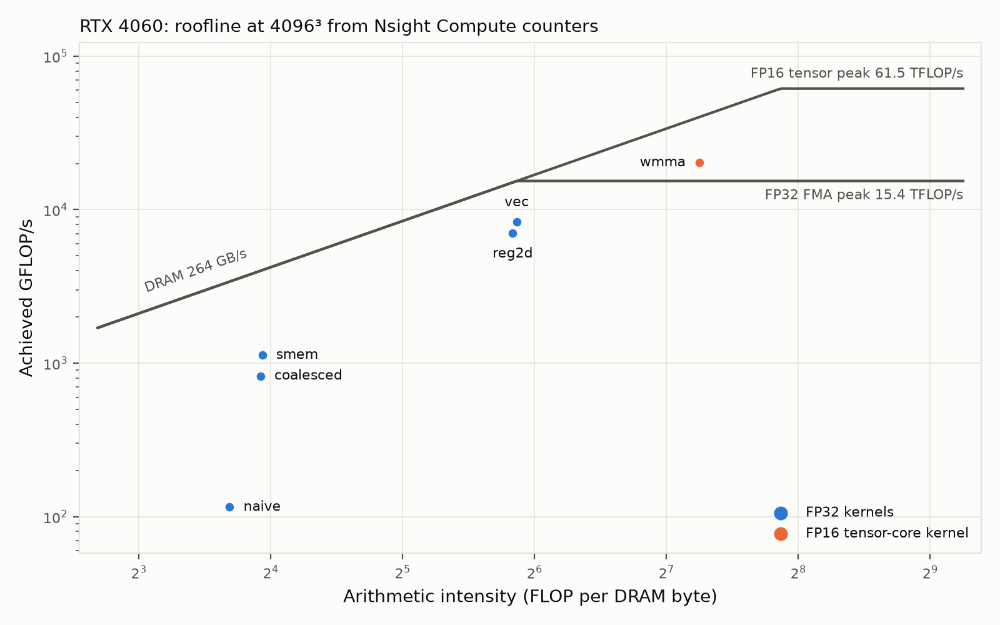
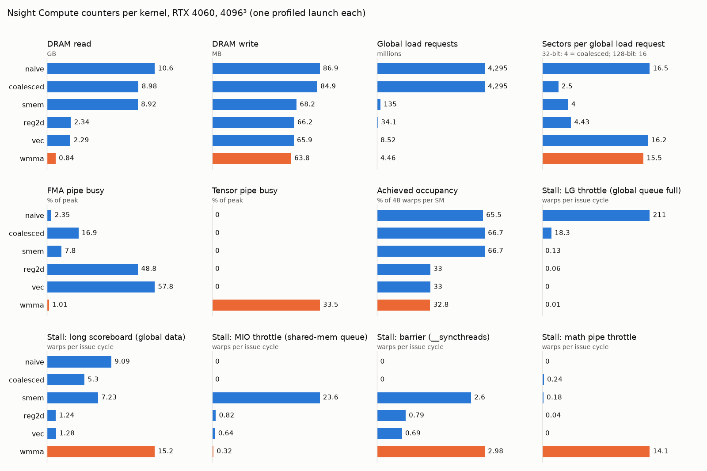
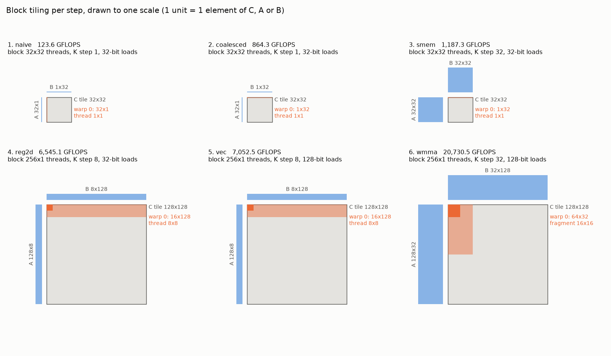

# CUDA GEMM

Matrix multiply in CUDA, built step by step from a naive kernel to tensor cores, with every step timed and checked against cuBLAS on the same inputs.

| Step | Kernel | Idea | GFLOPS (4096³) | % cuBLAS |
|---|---|---|---:|---:|
| 1 | `naive` | One thread per output | 123.6 | 1.7 |
| 2 | [`coalesced`](docs/steps/2-coalesced.md) | Warps read B and write C contiguously | 864.3 | 12.4 |
| 3 | [`smem`](docs/steps/3-smem.md) | Shared-memory tiles | 1,187 | 16.3 |
| 4 | [`reg2d`](docs/steps/4-reg2d.md) | 2D register blocking per thread | 6,545 | 80.4 |
| 5 | [`vec`](docs/steps/5-vec.md) | 128-bit loads, transposed A tile | 7,053 | 88.1 |
| 6 | [`wmma`](docs/steps/6-wmma.md) | Tensor cores (FP16 in, FP32 accumulate) | 20,731 | 65.3 |

Measured on an RTX 4060 (sm_89, CUDA 13.3), median of three runs ([raw](docs/results/rtx4060.csv)). `wmma` is compared with FP16-input cuBLAS.



## Why it matters

GEMM dominates deep-learning training and inference. Each step removes one bottleneck (uncoalesced loads, global traffic, shared-memory bandwidth, instruction issue, FP32 math) and explains the gain from SASS and Nsight Compute counters:



Tiles per step, to scale; the global loads they imply match the counters exactly for steps 1–5:



## Quick start

```sh
make toolchain                    # optional: local nvcc and cuBLAS (micromamba)
make check                        # compile for sm_75, sm_80, sm_89; no GPU needed
make bench ARCH=sm_89 KERNEL=vec  # on a GPU: time, GFLOPS, % cuBLAS, error as CSV
```

## Repository layout

| Path | Contents |
|---|---|
| `src/gemm.cuh` | Launcher signatures shared by every kernel |
| `src/<step>.cu` | One kernel per step |
| `src/bench.cu` | Harness: timing, cuBLAS reference, error check |
| `scripts/` | Roofline, counter and tiling plots from the result CSVs |
| `docs/steps/` | One note per step |
| `docs/results/` | Raw benchmark and Nsight Compute CSVs |

## Results and verification

- Every run checks `max_rel_err` against cuBLAS and fails above 1e-4 (FP32) or 1e-3 (FP16 inputs).
- Each step note in [docs/steps/](docs/steps/) gives what changed, why it is faster and what limits it next.
- Benchmarking, profiling and plots: [docs/running.md](docs/running.md).

## Limitations

- One GPU (RTX 4060 under WSL2); results on other architectures will differ.
- Tiled kernels need M, N and K to be multiples of 128; there is no edge handling.
- No double buffering or `cp.async`: loads and math do not overlap, which is the main gap left in `wmma`.

## Related projects

- [openroad-chip-lab](https://github.com/NicholasUnruh/openroad-chip-lab): a BF16 matrix tile from RTL to SKY130 layout: GEMM in custom silicon.
- [bf16-fpga](https://github.com/NicholasUnruh/bf16-fpga): that tile running on an FPGA.
- [rv32i-pipeline](https://github.com/NicholasUnruh/rv32i-pipeline), [cache-sim](https://github.com/NicholasUnruh/cache-sim): CPU pipeline and memory hierarchy.
- Portfolio: https://genwealth.world

## License

MIT. See [LICENSE](LICENSE).
