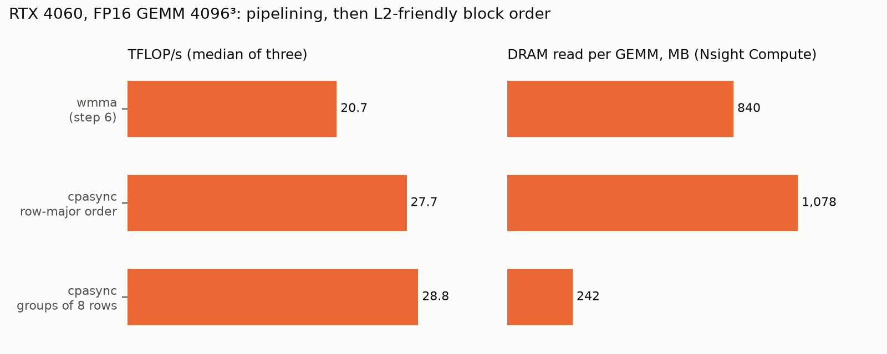

# Overlapping loads with tensor-core math

## Question

`wmma` (step 6) reaches 65% of FP16 cuBLAS. Is the gap the missing load/compute overlap, and how much does `cp.async` double buffering close?



What to notice: pipelining raised DRAM traffic, and the block-order fix took it below step 6's level.

## Concept

A GPU hides memory latency by switching to warps that are ready. In step 6 every warp of a block reaches the same `__syncthreads` after each load, so they all wait at once:

```
wmma, one K tile:  [load A,B -> regs -> smem] | sync | [MMA x16] | sync | [load ...
tensor cores:       idle .......................        busy             idle ...
```

Ampere added `cp.async`, a global-to-shared copy that bypasses registers and does not block. A thread issues copies, closes them into a group, and later waits until at most N groups remain in flight. With two buffers, tile t+1 is copied while tile t is multiplied:

```
copy t+1 -> buf[(t+1)%2]   (in flight)
MMA on buf[t%2]            <- overlaps the copy
wait for t+1; sync; swap
```

The hazard is refilling a buffer that is still being read: buffer `(t+1)%2` held tile t-1. One barrier per tile, after the wait and before the next copies, covers both conditions: the new data is in, and the old readers are done.

## What I tried

1. **Two barriers per tile** (copy t+1, wait for t, sync, compute, sync): 26,603, 26,070 and 27,382 GFLOPS at 4096 (82–87%).
2. **One barrier per tile**, blocks in row-major order: 27,682 GFLOPS (92.1%).
3. **Grouped block order.** The counters for variant 2 pointed at DRAM, so blocks were launched column by column within groups of 8 block rows.

## Output

```
                            kGroup=1      kGroup=8
dram__bytes_read.sum        1078391424    242438400
lts__t_sector_hit_rate.pct  67.92         92.76
gpu__time_duration.sum      4959744 ns    4764256 ns
tensor pipe % of peak       45.47         47.30

LDGSTS.E.BYPASS.128   global -> shared, 16 B, L1 bypassed (cp.async.cg)
LDGDEPBAR             cp.async.commit_group
DEPBAR.LE SB0         cp.async.wait_group
REG:122 SHARED:37888  (wmma: REG:126 SHARED:18944)
```

## Result

28,823 GFLOPS, 95.3% of FP16 cuBLAS (median of three).

- The gap was load latency: long-scoreboard stalls fell from 15.2 to 0.92 warps per issue cycle.
- Overlap exposed a second limit. Row-major order read 1.08 GB in 4.96 ms (217 GB/s of 264 GB/s), because the resident blocks stream all 32 MB of B through the 24 MB L2 once per block row. Grouping cut DRAM reads 4.4x.
- Dead end: group sizes 4, 8 and 16 differ by less than run-to-run noise (28.8–30.8 TFLOP/s across a two-run sweep).
- The tensor pipe stops just under 50% of its counter peak. GeForce Ada runs FP32-accumulate HMMA at half the FP16-accumulate rate, so this is close to the hardware limit.

## Next

FP8 (step 8) needs `mma.sync` PTX, because WMMA has no FP8 fragments on sm_89. `ldmatrix` cannot transpose 8-bit data, so B must be stored K-major (N x K), the same TN layout cuBLASLt FP8 requires. The benchmark generates B in that layout; the cost of transposing a row-major B is not measured here.
