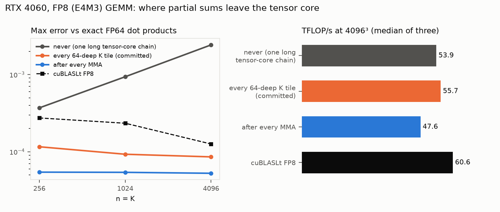

# FP8 on Ada tensor cores, and how they add

## Question

Ada's tensor cores take E4M3 inputs. How close does a hand-written `mma.sync` kernel get to cuBLASLt FP8, and is its error the error of the format or of the hardware?



What to notice: the never-promoted kernel's error grows about 6x from K = 256 to 4096, while promoting every 64-deep tile stays flat at no throughput cost.

## Concept

An FP8 MMA multiplies 8-bit inputs exactly and adds the products into an FP32 accumulator. "FP32 accumulator" says nothing about how the adder rounds. Like chip-lab's dot-product units, the tensor core aligns all addends to the largest one inside a fixed-width frame and drops what falls outside it.

A probe of one `mma.sync.m16n8k32` with hand-built operands measures that frame:

```
c = 2^13, + 1*1   ->  8193      (kept)
c = 2^14, + 1*1   ->  16384     (lost: about 13 bits below the leading bit)
c = -2^12, + 0.75 ->  -4095.5   (truncated toward -inf, not rounded)
c = 2^14, + 32 x 1*1 -> 16384   (each addend truncated before the sum)
```

Inside one long K loop the running sum sits in that accumulator, so once it is large the later small products vanish. The usual remedy is **promotion**: sum a short stretch of K in a fresh accumulator and add the result in FP32 registers.

## What I tried

1. **No promotion**, the step-7 structure with FP8 MMAs: 53.9 TFLOP/s. It failed the 1e-3 check against cuBLASLt at 4096, with error growing with K.
2. **Exact reference.** The check now compares against FP64 dot products of the same E4M3 codes. Against that reference cuBLASLt itself is off by 1.0–1.4e-4.
3. **Promotion after every MMA (k = 32):** error 4–6e-5, but 47.6 TFLOP/s, because the extra FADDs compete with the MMAs.
4. **Promotion every 64-deep K tile:** error 6–9e-5 and 55.7 TFLOP/s. This is the committed kernel.
5. **chip-lab's accuracy experiment** on the GPU (`bench numerics`): the same 2,000 vector pairs, scored the same way.

## Output

```
                                 TFLOP/s (4096)   max err vs exact (4096)
no promotion                      53.9            2.4e-3
promote every 64-deep K tile      55.7            6.1e-5 .. 9.4e-5
promote every MMA                 47.6            3.8e-5 .. 5.6e-5
cuBLASLt FP8                      60.6            9.6e-5 .. 1.4e-4

chip-lab vectors, K = 4096, median / p99    GPU               chip-lab C++ model
E4M3 per tensor, Gaussian                   6.22e-4 / 2.32e-3  6.2e-4 / 2.3e-3
BF16, Gaussian                              3.62e-5 / 1.40e-4  3.6e-5 / 1.4e-4
```

## Result

57,778 GFLOPS at 4096³, 93.3% of cuBLASLt FP8 (median of three), and 2.0x the FP16 kernel of step 7.

- The accuracy loss was the hardware adder, not the format. Promotion every 64-deep tile removes it at no measured cost.
- With promotion, GPU error on chip-lab's distributions matches the bit-exact C++ model to two digits. At K = 4096 the error is input rounding.
- Quantizing both 4096 x 4096 operands costs 1.25 ms against 2.41 ms of GEMM. Standalone quantization is memory-bound and would need fusing.
- The tensor pipe is 45% busy, as in step 7; cuBLASLt also stops near 61–63 TFLOP/s.

## Next

MX block scaling (step 9): one power-of-two scale per 32 elements. A k32 MMA covers exactly one block, so each partial sum must be scaled in FP32. That is promotion after every MMA, which costs 15% here even without the multiply.
