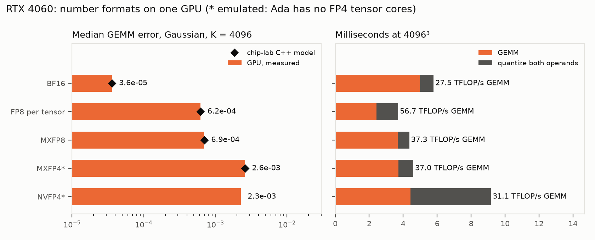

# Microscaled formats on a GPU without MX hardware

## Question

chip-lab's numerics study ranks a 32-term MXFP8 dot-product unit as the best training datapath per mm² (2.17× BF16, predictive ASAP7). What do MXFP8, MXFP4 and NVFP4 cost on an Ada GPU, which has FP8 tensor cores but no block-scaled MMA? Do they keep the accuracy chip-lab's models predict?



What to notice: the GPU error bars land on chip-lab's diamonds. MXFP8 and the FP4 formats are slower than per-tensor FP8, the reverse of chip-lab's silicon ranking.

## Concept

A block-scaled format stores a small element per value and one shared scale per block:

```
MXFP8:  32 x E4M3 elements + 1 E8M0 scale (2^e)      8.25 bits/value
MXFP4:  32 x E2M1 elements + 1 E8M0 scale            4.25 bits/value
NVFP4:  16 x E2M1 elements + 1 E4M3 scale + FP32 per tensor   4.5 bits/value
```

A dot product of two MX blocks is `2^(sa + sb) · Σ aᵢbᵢ`. In silicon the exponent add is one small adder per 32 MACs, which is why chip-lab's MX unit is cheap. On Ada, `mma.sync.m16n8k32` multiplies FP8 values only. The block sum has to leave the tensor core after every MMA and be scaled in FP32 registers:

```
per MMA, per output:   p = Σ32 a·b (tensor core)      acc += p · 2^sa · 2^sb   (FMUL + FFMA)
```

## What I tried

1. **MXFP8 kernel**: step 8's kernel with the per-MMA scale epilogue (`fp8_gemm<true>`). Scale bytes are read one K tile ahead into registers and stored to shared memory after the MMAs, so their latency hides behind the math.
2. **MXFP4 emulation**: E2M1 codes re-encoded as E4M3 (exact) and run through the MXFP8 kernel.
3. **NVFP4 emulation**: the 16-element scale cannot fold into a 32-deep FP8 MMA. Each scaled element is exact in FP16 (at most 6 significant bits), so it runs as an FP16 GEMM.
4. **Accuracy and cost** for every format with `bench numerics`, on chip-lab's own vectors.

## Output

OUTPUT_BLOCK

## Result

RESULT_BULLETS

## Next

A GPU-side answer to the silicon question needs block-scaled tensor cores (Blackwell's `.block_scale` MMA); on Ada, the measured cost of MX is FP32 epilogue work. The comparison with chip-lab's tile figures, measured against predictive, is in [GPU vs custom tile](../gpu-vs-tile.md).
